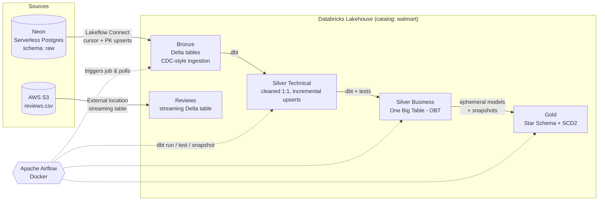

# 🛒 Walmart Lakehouse: End-to-End Data Engineering Project

> A production-style, fully reproducible data engineering project built on a **Lakehouse architecture**: **Neon (serverless Postgres)** → **Databricks + Delta Lake** → **dbt** (Bronze → Silver → Gold) → orchestrated by **Apache Airflow** running in **Docker**, with an **AWS S3** data lake for file ingestion.


---

## 📑 Table of Contents

1. [Project Summary (TL;DR)](#-project-summary-tldr)
2. [Pipeline in Action](#-pipeline-in-action)
3. [Goals and What You Learn](#-goals-and-what-you-learn)
4. [Architecture](#️-architecture)
5. [Tech Stack](#-tech-stack)
6. [Core Concepts Explained](#-core-concepts-explained)
7. [Repository Structure](#-repository-structure)
8. [Dataset](#️-dataset)
9. [Pipeline Walkthrough (Step by Step)](#-pipeline-walkthrough-step-by-step)
   - [Step 1: Source database (Neon)](#step-1-source-database-neon-postgres)
   - [Step 2: Bronze layer (Databricks ingestion)](#step-2-bronze-layer-cdc-style-ingestion-in-databricks)
   - [Step 3: dbt setup](#step-3-dbt-setup)
   - [Step 4: Sources and Silver Technical](#step-4-sources-and-silver-technical-layer)
   - [Step 5: Custom schema macro](#step-5-custom-schema-names-macro)
   - [Step 6: Data quality tests](#step-6-data-quality-tests)
   - [Step 7: Silver Business, the One Big Table](#step-7-silver-business-metadata-driven-one-big-table)
   - [Step 8: Gold, the dimensional model](#step-8-gold-layer-star-schema-with-scd-type-2)
   - [Step 9: Airflow orchestration](#step-9-orchestration-with-apache-airflow)
   - [Step 10: S3 reviews ingestion](#step-10-s3-reviews-ingestion)
   - [Step 11: Scheduling](#step-11-scheduling-the-dag)
   - [Step 12: Push to GitHub](#step-12-version-control-and-github)
10. [Getting Started (Quick Start)](#-getting-started-quick-start)
11. [Command Cheat Sheet](#-command-cheat-sheet)
12. [Data Quality Summary](#-data-quality-summary)
13. [Troubleshooting](#️-troubleshooting)
14. [Security Notes](#-security-notes)
15. [Interview Talking Points](#-interview-talking-points)
16. [Future Improvements](#-future-improvements)
17. [Acknowledgements](#-acknowledgements)

---

## 📌 Project Summary (TL;DR)

| Item | Detail |
|---|---|
| **Domain** | Retail (simulated Walmart dataset) |
| **Source systems** | Neon serverless Postgres (6 tables) + AWS S3 (`reviews.csv`) |
| **Platform** | Databricks Free Edition (Unity Catalog, Delta Lake, serverless SQL warehouse) |
| **Architecture** | Lakehouse with Medallion layers: Bronze → Silver (Technical + Business) → Gold |
| **Ingestion** | CDC-style, query-based incremental loading with cursor column + primary key (idempotent upserts) |
| **Transformations** | dbt Core with `dbt-databricks` adapter |
| **Modeling** | One Big Table (OBT) → Star schema with SCD Type 2 dimensions |
| **Orchestration** | Apache Airflow 3.x in Docker (custom image with dbt) |
| **Quality** | dbt generic + singular tests, severity levels, source freshness |
| **Deployment** | GitHub (portfolio-ready) |

**In one sentence:** raw retail data is pulled incrementally from Postgres into Delta tables, cleaned and joined with dbt, modeled into a star schema with history tracking, and the whole chain runs automatically every day through an Airflow DAG.

---

## 🎬 Pipeline in Action

A manual run of the `orchestrate` DAG in the Airflow UI. Each of the 10 tasks runs in order and the next one only starts when the previous one succeeds.

<p align="center">
  
  <br/>
  <em><strong>1. Start of the run.</strong> <code>ingest_cdc</code> (Databricks job trigger and polling) and <code>clean_target</code> have succeeded; <code>source_freshness</code> is running and the rest of the DAG is waiting.</em>
</p>

<p align="center">
  
  <br/>
  <em><strong>2. Silver Technical.</strong> <code>silver_technical</code> has built the incremental models and <code>silver_technical_tests</code> is validating them. A failing test here would stop the pipeline before the business layer.</em>
</p>

<p align="center">
  
  <br/>
  <em><strong>3. Gold layer.</strong> Silver Business (OBT) and its tests have passed, the ephemeral models are done, and <code>gold_dimensions</code> is running <code>dbt snapshot</code> to build the SCD Type 2 dimensions.</em>
</p>

<p align="center">
  
  <br/>
  <em><strong>4. Run completed.</strong> All tasks are green, ending with <code>gold_facts</code> (the log is shown on the right).</em>
</p>

---

## 🎯 Goals and What You Learn

This project simulates what it feels like to work in a real data engineering team. Each piece maps to a skill commonly requested in data engineering job descriptions.

**Skills demonstrated**

- **Lakehouse architecture**: cheap data-lake storage combined with warehouse-grade performance through an open table format (Delta Lake).
- **Incremental ingestion without touching the source**: no CDC or change tracking needs to be enabled on the source database.
- **Idempotent pipelines**: re-running never creates duplicates.
- **Metadata-driven pipelines**: SQL generated from a configuration list using Jinja, so new columns or tables are configuration changes and not query rewrites.
- **Dimensional modeling**: star schema, fact and dimension tables, grain, composite keys, natural vs. surrogate keys.
- **Slowly Changing Dimensions (Type 2)** using dbt snapshots.
- **dbt engineering**: sources, incremental models, ephemeral models, macros, custom schemas, generic and singular tests, severity, lineage.
- **Orchestration**: DAG design, dependencies, Docker image customization, triggering external jobs through an SDK and waiting for completion, scheduling, back-filling.
- **Cloud integration**: Databricks ↔ AWS S3 via an external location.
- **Engineering hygiene**: Git, branches, `.gitignore`, secrets handling.

---

## 🏗️ Architecture



### Layers at a glance

| Layer | Schema | Materialization | Description |
|---|---|---|---|
| **Bronze** | `walmart.bronze` | Delta tables (managed by Databricks pipeline) | Raw copies of the 6 source tables, loaded incrementally |
| **Silver Technical** | `walmart.silver_t` | `incremental` (upsert by key) | Cleaned 1:1 versions of bronze tables, with a `processed_at` audit column |
| **Silver Business** | `walmart.silver_b` | `table` | `obt`: one big denormalized table generated dynamically with Jinja |
| **Gold** | `walmart.gold` | `table` + snapshots + ephemeral | Star schema: SCD2 dimensions + `fact_orders` |

### Why Bronze / Silver / Gold?

- **Bronze**: the "dump" layer. Data is stored as-is from the sources so nothing is lost and reprocessing is always possible.
- **Silver**: cleaned and conformed data. Split here into two sub-layers:
  - *Technical*: hygiene only (type fixes, filters, audit columns), still 1:1 with the source tables.
  - *Business*: business logic and joins (the OBT).
- **Gold**: consumption layer, modeled for analytics (star schema), ready for BI tools and KPIs.

---

## 🧰 Tech Stack

| Tool | Purpose | Why it was chosen |
|---|---|---|
| **Neon** | Hosted serverless Postgres (source DB) | Free tier, SSL, instant **branching** for safe experiments |
| **Databricks (Free Edition)** | Lakehouse platform: Spark, Delta Lake, Unity Catalog, Lakeflow Connect, Jobs | Managed Spark + Delta, no cluster management |
| **Delta Lake** | Open table format | ACID transactions, upserts (`MERGE`), time travel on cheap storage |
| **dbt Core + dbt-databricks** | SQL transformations, tests, snapshots, lineage | One workflow regardless of the warehouse; the compute stays in Databricks |
| **Apache Airflow 3.x** | Orchestration and scheduling | Industry-standard, Pythonic, great UI |
| **Docker / Docker Compose** | Run Airflow locally with a custom image | Isolation and reproducibility |
| **AWS S3** | Data lake for the reviews file | Most popular object store |
| **Databricks SDK for Python** | Trigger and monitor Databricks jobs from Airflow | Programmatic access to the Databricks API |
| **Git & GitHub** | Version control, portfolio | Shareable proof of work |
| **VS Code + dbt Power User** | IDE (query preview, compiled SQL, lineage view) | Productivity while developing dbt models |
| **uv** | Python package and virtual-environment manager | Modern and fast |

> **Python version:** use **3.11 or 3.12**. Python 3.13 has limited dbt compatibility.

---

## 📚 Core Concepts Explained

A mini-glossary so every design decision in this repo makes sense.

### Lakehouse
A **data lake** (cheap object storage, files of any kind) combined with a **warehouse engine** (SQL performance, transactions) through an **open table format** such as **Delta Lake**. You store data cheaply but query it with warehouse-level speed and reliability.

### Delta Lake
Adds ACID transactions, schema enforcement, `MERGE`/upsert, and time travel on top of Parquet files. Every table created in this project is a Delta table.

### Databricks and Apache Spark
Spark is the distributed processing engine. Databricks is the managed product built by Spark's creators that handles clusters, infrastructure, and optimization. In this project, **dbt does not process data**; it only generates SQL, and **Databricks compute executes it**.

### Unity Catalog: Catalog → Schema → Table
A catalog behaves like a database. Here: catalog `walmart`, schemas `bronze`, `silver_t`, `silver_b`, `gold`.

### CDC-style (query-based) incremental ingestion
True CDC / SQL Server change tracking requires admin work on the source. Here, Databricks Lakeflow Connect uses:
- a **cursor column** (`updated_timestamp`) to detect new/changed rows, and
- a **primary key** to decide between insert and update.

Result: **incremental loads + upserts + idempotency with zero source-side configuration**.

### Upsert
*Update + Insert.* New key → insert. Existing key with changed values → update. Example: product `P101` is "pen"; later it arrives as "super pen" → the row is updated, not duplicated.

### Idempotency
Running the same pipeline twice yields the same result. Verified in this project: a second run reported **0 upserts, 0 deletes**, and the row count stayed identical.

### Pipeline vs. Job (Databricks)
- **Pipeline**: the real ingestion logic (Databricks generates and runs the PySpark/declarative code).
- **Job**: an orchestration wrapper that runs tasks (such as a pipeline) on a schedule or on demand. Airflow triggers the **job**.

### dbt: the "T" in ELT
dbt acts as a lightweight middle layer. You write `SELECT` statements, and it builds tables/views/incrementals, runs tests, and tracks lineage. It has no compute engine of its own.

### Jinja templating
Double curly braces `{{ }}` evaluate expressions; `` runs control flow (`if`, `for`, `set`). It makes SQL dynamic: conditional filters, loops, variables.

### Incremental model
Processes only new/changed rows on subsequent runs. Uses `is_incremental()` (true only when the table already exists and no full refresh is requested) and `{{ this }}` (the target table itself).

### Ephemeral model
Never materialized in the warehouse. dbt inlines it as a CTE inside dependent models. Perfect for "staging" definitions of dimensions.

### Snapshot (SCD Type 2)
dbt's implementation of slowly changing dimensions. When a tracked record changes, the old row is closed (`dbt_valid_to` set) and a new row is inserted (`dbt_valid_from`).

### One Big Table (OBT)
All required data joined into one wide table. It lets you focus on transformations first and do formal modeling afterwards.

### Metadata-driven pipeline
Instead of hard-coding a long `JOIN` query, you describe tables/columns/join conditions in a config list and a Jinja loop generates the SQL. Scaling = editing configuration.

### DAG
**Directed Acyclic Graph**: tasks with a direction (what runs after what) and **no cycles** (you can never loop back).

### Bind mount (Docker)
Syncs a local folder with a folder inside the container so edits are reflected live. Used for `dags/`, `logs/`, `config/`, `plugins/` and the dbt project.

---

## 📂 Repository Structure

```
.
├── airflow/
│   ├── dags/
│   │   └── orchestrate.py          # Main DAG
│   ├── plugins/
│   ├── config/
│   ├── logs/
│   ├── walmart_project/            # dbt project (bind-mounted into Airflow)
│   │   ├── models/
│   │   │   ├── source/             # sources.yml
│   │   │   ├── silver_t/           # technical layer + properties.yml (tests)
│   │   │   ├── silver_b/           # OBT (metadata-driven Jinja) + tests
│   │   │   └── gold/
│   │   │       ├── ephemeral/      # eph_customers, eph_products, eph_stores,
│   │   │       │                   # eph_employees, eph_orders
│   │   │       └── fact/           # fact_orders
│   │   ├── snapshots/              # dim_*.yml (SCD Type 2)
│   │   ├── macros/                 # custom generate_schema_name
│   │   ├── tests/                  # singular tests (e.g. test_obt)
│   │   ├── dbt_project.yml
│   │   └── profiles.yml
│   ├── Dockerfile                  # Custom Airflow image with dbt installed
│   ├── docker-compose.yaml
│   ├── requirements.txt
│   └── .env
├── data/                           # Walmart dataset (DDL + CSV files)
└── README.md
```

> Adjust folder names to match your actual repo.

---

## 🗃️ Dataset

A **simulated** Walmart retail dataset with six source tables in the `raw` schema of the Postgres database, plus one file in S3.

| Table | Grain / key | Main attributes |
|---|---|---|
| `customers` | 1 row per customer (`customer_id`) | first/last name, email, phone, city, province, country, created/updated timestamps, `is_active` |
| `products` | 1 row per product (`product_id`) | name, category, brand, price, timestamps, `is_active` |
| `stores` | 1 row per store (`store_id`) | name, city, province, country, timestamps, `is_active` |
| `employees` | 1 row per employee (`employee_id`) | first/last name, email, salary, job title, `store_id`, timestamps, `is_active` |
| `orders` | 1 row per order (`order_id`) | store, payment method, order status, order timestamp, timestamps, `is_active` |
| `order_items` | 1 row per line item (`order_item_id`) | `order_id`, `product_id`, quantity, unit price, line amount |
| `reviews.csv` (S3) | n/a | product reviews; standalone, not part of the dimensional model |

> Column names above are the ones used in the models; check `data/ddl.sql` for the exact schema.

**Reference volumes seen during development** (useful as sanity checks):

| Object | Approx. rows |
|---|---|
| `bronze.order_items` | ~30,000 |
| `silver_t.orders` (after `is_active` filter, first version) | 9,450 |
| `products` | 500 |
| `gold.dim_customers` | ~1,991 |
| `silver_b.obt` | ~300,000 rows, 57 columns (many-to-many via order items) |

---

## 🔄 Pipeline Walkthrough (Step by Step)

### Step 1: Source database (Neon Postgres)

1. Create a Neon project with a database `walmart_db` and a schema `raw`.
2. Run the DDL script from `data/` to create the six tables, then load the CSVs (`COPY` / `\copy`, or a small Python loader using `COPY`).
3. Copy the connection string (Neon console → **Connect**):
   ```
   postgresql://<user>:<password>@<host>.neon.tech/walmart_db?sslmode=require
   ```
4. Keep it in `.env` (never commit it).

**Branching for safety.** Exploring a production database directly is risky: a wrong query could modify or delete data. Neon **branches** are instant copy-on-write clones. Create a branch and run ad-hoc analysis there (find primary keys, count rows, compute average order size per customer, etc.) so the main branch stays untouched.

> The original tutorial used an "agentic" Postgres (Ghost) driven through an MCP server inside VS Code. This version uses Neon, which provides the same fork/branch safety idea. An MCP-capable assistant can also be connected to Neon for natural-language querying.

---

### Step 2: Bronze layer, CDC-style ingestion in Databricks

**2.1 Create the catalog and schema**

UI: *Catalog → + → Create catalog* → name `walmart` (default storage). If the UI fails, use a notebook:

```sql
CREATE CATALOG IF NOT EXISTS walmart;
CREATE SCHEMA  IF NOT EXISTS walmart.bronze;
```

Default schemas `default` and `information_schema` appear automatically. `information_schema` holds metadata (schemas, tables, columns) and is handy for AI agents that need context.

**2.2 Create the connection to Neon**

*Data ingestion → PostgreSQL → Create connection* (`walmart_conn`):

| Field | Value |
|---|---|
| Host | `<host>.neon.tech` |
| Port | `5432` |
| User / Password | from the connection string |
| Database | `walmart_db` (the actual database name) |
| SSL | required (`sslmode=require`) |

**2.3 Create the ingestion pipeline (Lakeflow Connect)**

- Pipeline name e.g. `ingest_walmart`, destination `walmart.bronze`.
- Source database → schema `raw` → select **all six tables**.
- Per-table settings:

| Table | Cursor column | Primary key |
|---|---|---|
| customers | `updated_timestamp` | `customer_id` |
| employees | `updated_timestamp` | `employee_id` |
| order_items | `updated_timestamp` | `order_item_id` |
| orders | `updated_timestamp` | `order_id` |
| products | `updated_timestamp` | `product_id` |
| stores | `updated_timestamp` | `store_id` |

- **History tracking: off** (not needed for source/bronze copies). **Columns: all.**
- Optionally add an email recipient for failure notifications.

**How the cursor works:** Databricks remembers the highest `updated_timestamp` it loaded. On the next run it only reads rows with a greater timestamp; the primary key then decides insert vs. update.

**2.4 Verify idempotency**

```sql
SELECT COUNT(*) FROM walmart.bronze.order_items;   -- ~30,000
```
Re-run the pipeline: upserted = 0, deleted = 0, and the count is unchanged. ✅

**2.5 Wrap in a Job**

A **Job** that contains the pipeline task is what Airflow will trigger. It can also be scheduled inside Databricks (e.g. hourly). When Airflow orchestrates it, **pause the Databricks schedule** to avoid double runs. Note the **Job ID** (Job page → details).

> **Decoupling note:** if several projects consume the same source, you would keep ingestion scheduled independently (e.g. hourly) and not tie it to a single DAG. Here there is one consumer, so Airflow owns the trigger.

---

### Step 3: dbt setup

**3.1 Environment**

```bash
pip install uv
uv init
uv sync
source .venv/bin/activate          # Windows: .venv\Scripts\activate
uv add dbt-core dbt-databricks
git --version && python --version  # sanity check (Python 3.11/3.12)
```

**3.2 Initialize the project**

```bash
dbt init
```
Answer the prompts:

| Prompt | Answer |
|---|---|
| Project name | `walmart_project` |
| Adapter | `databricks` |
| Host | SQL Warehouse → *Connection details* → Server hostname |
| HTTP path | SQL Warehouse → *Connection details* → HTTP path |
| Auth | Personal access token (Profile → Settings → Developer → Access tokens) |
| Unity Catalog | yes → catalog `walmart` |
| Schema | `dbt_schema` (default dev schema) |
| Threads | `1` |

**3.3 profiles.yml**

dbt writes `profiles.yml` to `~/.dbt/`. Copy it **into the project folder**: dbt looks there first, and it keeps deployments self-contained. Keep only the profile related to this project.

```yaml
walmart_project:
  target: dev
  outputs:
    dev:
      type: databricks
      host: <your-workspace-host>
      http_path: <sql-warehouse-http-path>
      token: "{{ env_var('DATABRICKS_TOKEN') }}"
      catalog: walmart
      schema: dbt_schema
      threads: 1
```

`target: dev` means this is the development environment; add `qa`/`prod` targets later.

**3.4 VS Code configuration (dbt Power User)**

Install **dbt Power User** and:

1. Select the **`.venv` interpreter** (otherwise: "dbt core is not installed").
2. Add **file associations** so `.sql` and `.yml` files are rendered as Jinja:

| Pattern | Value |
|---|---|
| `*.sql` | `jinja-sql` |
| `*.yaml` / `*.yml` | `jinja-yaml` |

3. Run *Validate setup*. You can now preview query results, see compiled SQL, and view lineage inside VS Code.

**3.5 Verify**

```bash
cd walmart_project
dbt debug          # expect: All checks passed!
```

**3.6 Project layout rules**

`dbt_project.yml` declares `model-paths`, `snapshot-paths`, `macro-paths`, `test-paths`, `seed-paths`. Keep the defaults, which are an industry convention. Delete the generated `example` models (and any leftover `marts` block in `dbt_project.yml`, otherwise dbt warns about an unused configuration).

---

### Step 4: Sources and Silver Technical layer

**4.1 Declare sources** (`models/source/sources.yml`)

```yaml
version: 2

sources:
  - name: walmart_databricks
    database: walmart        # the catalog
    schema: bronze
    tables:
      - name: customers
      - name: employees
      - name: order_items
      - name: orders
      - name: products
      - name: stores
```

> YAML indentation matters. A leading `-` creates a list item. This is the YAML equivalent of nested JSON.

**Why declare sources?** Querying `walmart.bronze.customers` directly works but has **no lineage**. Using `{{ source('walmart_databricks','orders') }}` makes dbt aware of the dependency, so the lineage graph and `source freshness` work.

**4.2 Silver Technical models** (`models/silver_t/*_t.sql`)

Pattern for `orders_t.sql`:

```sql
{{ config(materialized='incremental', unique_key='order_id') }}

select
    *,
    current_timestamp() as processed_at
from {{ source('walmart_databricks', 'orders') }}


where updated_timestamp >= (
    select coalesce(max(updated_timestamp), '1900-01-01') from {{ this }}
)

```

How it works:

- `materialized='incremental'` + `unique_key` → on later runs dbt **merges** (upserts) by that key.
- `is_incremental()` is a **built-in** dbt function: true only when the target table already exists and `--full-refresh` is not used.
- `{{ this }}` refers to the model's own target table.
- `coalesce(..., '1900-01-01')` handles the first run (empty target → load everything).
- `processed_at` is an audit column recording when dbt processed the row.

Created models: `orders_t`, `products_t`, `employees_t`, `stores_t`, `customers_t`, `order_items_t`. Each uses its own key (`product_id`, `employee_id`, ...).

> **Note on `is_active`.** An early version filtered `where is_active = 'Y'`. This was **removed**: for reporting you must keep history, including inactive customers/orders. Because the earlier runs had already filtered data, a `dbt run --full-refresh` rebuilt everything.

**4.3 Configuration levels**

The same configuration can live at three levels (later levels override earlier ones):

1. **Inline** in the model: `{{ config(...) }}`
2. **Folder-level** in `dbt_project.yml` under `models:`
3. **Properties file** (`properties.yml`) next to the models

This project sets materialization and schema at the **project level**:

```yaml
models:
  walmart_project:
    +materialized: incremental
    silver_t:
      +schema: silver_t
    silver_b:
      +materialized: table
      +schema: silver_b
    gold:
      +materialized: table
      +schema: gold
      ephemeral:
        +materialized: ephemeral
```

**4.4 Full refresh**

```bash
dbt run --full-refresh
```
Rebuilds incremental models from scratch (needed after changing the logic or the filter).

---

### Step 5: Custom schema names (macro)

By default dbt names schemas `<target_schema>_<custom_schema>`, which would create `dbt_schema_silver_t`. To get clean names (`silver_t`, `silver_b`, `gold`), override the built-in macro in `macros/custom_schema.sql`:

```sql

    
        {{ target.schema }}
    
        {{ custom_schema_name | trim }}
    

```

Default dev behavior (prefixing) is good when many developers share a workspace; for the final layers use clean names.

---

### Step 6: Data quality tests

**6.1 Generic tests** in `models/silver_t/properties.yml`:

```yaml
version: 2

models:
  - name: products_t
    columns:
      - name: product_id
        data_tests:
          - not_null
          - unique
      - name: price
        data_tests:
          - dbt_utils.accepted_range:   # or use a custom expression test
              min_value: 0
              inclusive: false
```

The tutorial used a `where`-based configuration for the price check:

```yaml
      - name: price
        data_tests:
          - not_null:
              config:
                where: "price > 0"
```
Pick whichever fits your installed packages; the intent is **price must be > 0**.

> Indentation tip: `config` is indented under the test name, and `where` under `config`.

Why test? A single negative sign on a price column can distort a company's balance sheet, so invalid data must be caught before it moves downstream.

**6.2 Severity**

```yaml
config:
  severity: warn            # warn instead of failing the run
  # or thresholds:
  # error_if: ">1000"
  # warn_if: ">10"
```
A handful of bad rows → warning; thousands → error.

**6.3 Singular (custom) tests**: `tests/test_obt.sql`

A singular test is a SQL query that **should return zero rows**. If it returns rows, the test fails.

```sql
{{ config(severity='warn') }}

select 1
from {{ ref('obt') }} as obt
where obt.order_id is null
   or obt.order_item_id is null
   or obt.product_id is null
   or obt.employee_id is null
   or obt.store_id is null
   or obt.customer_id is null
```

Run with:
```bash
dbt test
```
> Always create the tables first (`dbt run`), otherwise tests fail simply because the table does not exist.

---

### Step 7: Silver Business: metadata-driven One Big Table

**Goal:** join `orders`, `customers`, `order_items`, `products`, `employees`, `stores` into one table, **without a hard-coded query**.

**7.1 The configuration** (top of `models/silver_b/obt.sql`)

```jinja
{% set config_list = [
    {
        "table": "walmart.silver_t.orders_t",
        "alias": "o",
        "columns": "o.order_id, o.store_id, o.payment_method, o.order_status, o.updated_timestamp AS order_updated_timestamp"
    },
    {
        "table": "walmart.silver_t.customers_t",
        "alias": "c",
        "columns": "c.customer_id, c.first_name, c.last_name, c.email",
        "join_condition": "o.customer_id = c.customer_id"
    },
    {
        "table": "walmart.silver_t.order_items_t",
        "alias": "oi",
        "columns": "oi.order_item_id, oi.product_id, oi.quantity, oi.unit_price, oi.line_amount",
        "join_condition": "o.order_id = oi.order_id"
    },
    {
        "table": "walmart.silver_t.products_t",
        "alias": "p",
        "columns": "p.product_name, p.category, p.brand, p.price",
        "join_condition": "oi.product_id = p.product_id"
    },
    {
        "table": "walmart.silver_t.employees_t",
        "alias": "e",
        "columns": "e.employee_id, e.job_title, e.salary",
        "join_condition": "o.store_id = e.store_id"
    },
    {
        "table": "walmart.silver_t.stores_t",
        "alias": "s",
        "columns": "s.store_name, s.city AS store_city",
        "join_condition": "o.store_id = s.store_id"
    }
] %}
```

Design rules:

- The **first** entry is the **base table** and has **no** `join_condition`.
- Columns are kept as **one string** (not a list) because we are generating SQL text.
- No trailing comma inside the string; the loop handles commas.
- Use aliases consistently so join conditions match the generated query.
- (Adjust table/column names to your actual schema.)

**7.2 The generator** (below the config)

```jinja
select
    
        {{ cfg["columns"] }},
    ,
    current_timestamp() as obt_processed_at

from

    
        {{ cfg["table"] }} as {{ cfg["alias"] }}
    
        left join {{ cfg["table"] }} as {{ cfg["alias"] }}
            on {{ cfg["join_condition"] }}
    

```

What each construct does:

| Construct | Purpose |
|---|---|
| `` | Defines a Jinja variable (list of dicts) |
| `` | Loops over every table config |
| `loop.last` | Avoids a trailing comma after the final column group |
| `loop.first` | The first table goes in `FROM`; the rest become `LEFT JOIN`s |
| `{{ ... }}` | Prints the value into the generated SQL |

**7.3 Inspect the compiled SQL**

In VS Code: *dbt Power User → Compile dbt preview*, or `dbt compile`, then look under `target/compiled/`.

**7.4 Why this matters**

- New column? Edit one string.
- New table? Add one dict.
- No risk of breaking a hand-written 100-line query in production.

**7.5 Materialization**

`silver_b` is set to `table` and written to schema `silver_b`. A full build yields ~57 columns and ~300k rows (expected, since order items create many-to-many expansion).

> While developing, a duplicated `stores` entry in the config list created a duplicate join. Always double-check the list for repeated tables.

---

### Step 8: Gold layer, star schema with SCD Type 2

**8.1 Design phase**

Looking at the OBT columns, group them by **business context**:

| Dimension | Content |
|---|---|
| `dim_customers` | customer attributes |
| `dim_products` | product name, category, brand, **price** (descriptive context here, not an aggregated measure) |
| `dim_stores` | store attributes |
| `dim_employees` | employee attributes (relevant for an offline store: who handled the order) |
| `dim_orders` | **dimension of the model itself**: order status, payment method (merged here because it is a single attribute, a "junk"-style dimension), order timestamps |
| `fact_orders` | keys + numeric measures |

**8.2 Ephemeral models** (`models/gold/ephemeral/eph_*.sql`)

```sql
select distinct
    customer_id,
    customer_first_name,
    customer_last_name,
    customer_email,
    customer_phone,
    customer_city,
    customer_province,
    customer_country,
    customer_created_timestamp,
    customer_updated_timestamp,
    customer_is_active,
    customer_processed_at,
    current_timestamp() as customer_gold_processed_at
from {{ ref('obt') }}
```

- `distinct` is essential: the OBT repeats each customer for every order item.
- Ephemeral = nothing is created in Databricks; dbt inlines the query as a CTE.
- Models created: `eph_customers`, `eph_products`, `eph_stores`, `eph_employees`, `eph_orders`.

**8.3 Snapshots → SCD Type 2 dimensions** (`snapshots/dim_customers.yml`)

```yaml
snapshots:
  - name: dim_customers
    relation: ref('eph_customers')
    config:
      database: walmart
      schema: gold
      unique_key: customer_id
      strategy: timestamp
      updated_at: customer_updated_timestamp
      dbt_valid_to_current: "to_date('9999-12-31')"
```

Meaning of each setting:

| Setting | Explanation |
|---|---|
| `relation: ref(...)` | Source of the snapshot. Use `ref` for dbt models (use `source` only for declared sources) |
| `unique_key` | Business key; decides "new record vs. changed record" |
| `strategy: timestamp` | Change detection based on an `updated_at` column |
| `updated_at` | Also used to order multiple changes within one load, so the **latest** version wins |
| `dbt_valid_to_current` | Value used for "currently valid" rows (avoids NULLs) |

Automatically added columns: `dbt_scd_id`, `dbt_updated_at`, `dbt_valid_from`, `dbt_valid_to`.

**Example of SCD2 behaviour**

| customer_id | name | dbt_valid_from | dbt_valid_to |
|---|---|---|---|
| 1 | Rahul | 2026-01-01 | 2026-01-05 |
| 1 | Rahul S. | 2026-01-05 | 9999-12-31 |

One snapshot YAML per dimension (easier to debug): `dim_customers`, `dim_products`, `dim_stores`, `dim_employees`, `dim_orders`.

```bash
dbt snapshot
```
Run it twice to confirm no duplicates are inserted (e.g. `dim_customers` stays at the same row count).

**8.4 Fact table** (`models/gold/fact/fact_orders.sql`)

```sql
select
    order_id,
    order_item_id,
    product_id,
    store_id,
    employee_id,
    customer_id,
    total_amount,
    quantity,
    unit_price,
    line_amount
from {{ ref('obt') }}
```

- **Grain:** one row per order line item *per employee of the store* (because employee is a dimension in this design).
- Holds **keys** and **numeric measures** only. Descriptive context and timestamps live in dimensions.
- **Natural keys** are used directly as join keys. Surrogate keys are only needed when natural keys are unwieldy or when you must join to a specific SCD version.

**8.5 Querying the star schema: the composite-key gotcha**

The fact's primary key is the **combination** of the IDs (`order_id`, `order_item_id`, `product_id`, `store_id`, `employee_id`, `customer_id`). One order can contain many items.

```sql
-- ❌ Rows explode (e.g. 50 rows become 250)
select f.*, d.*
from walmart.gold.fact_orders f
left join walmart.gold.dim_orders d
  on f.order_id = d.order_id;

-- ✅ Join on BOTH keys
select f.*, d.*
from walmart.gold.fact_orders f
left join walmart.gold.dim_orders d
  on  f.order_id      = d.order_id
  and f.order_item_id = d.order_item_id;
```

The model is not wrong: the join has to respect the composite key.

**8.6 Design trade-off: employee in the fact table**

Including the employee dimension means one order/item can appear once per employee of that store. It enables "who handled this order?" analysis (e.g. for a customer-service complaint) without a snowflake join. The alternative is a **snowflake schema** (`fact → store → employees`), which costs extra hierarchical joins. Decide based on business needs and the performance vs. storage trade-off.

---

### Step 9: Orchestration with Apache Airflow

Airflow is an **orchestrator**, not a processing engine. It decides **what runs, when, and in what order**; Databricks (Spark) and dbt (SQL on Databricks) do the heavy work.

**9.1 Docker setup**

Install **Docker Desktop**. On Windows you must enable virtualization and **WSL2** (with Ubuntu) first.

Folder layout (all at the same level as `docker-compose.yaml`):

```bash
cd airflow
mkdir dags plugins logs config
echo "AIRFLOW_UID=50000" > .env
```

Download the official `docker-compose.yaml` for Airflow, then edit it:

1. **Use a custom image:** comment out the default `image:` line (with `#`, not by deleting) and use `build: .`
2. **Bind-mount the dbt project** by adding to the `volumes:` list:
   ```yaml
   - ${AIRFLOW_PROJ_DIR:-.}/walmart_project:/opt/airflow/walmart_project
   ```
3. **Disable the example DAGs:** `AIRFLOW__CORE__LOAD_EXAMPLES: 'false'`
4. Copy your dbt project folder into `airflow/`.

> If YAML parsing fails after commenting something out, make sure the comment starts with `#`.

**9.2 Custom Docker image** (`airflow/Dockerfile`)

The stock Airflow image does not include dbt (`dbt: command not found`, exit code 127). Build your own:

```dockerfile
FROM apache/airflow:3.2.0

USER root
RUN apt-get update \
 && apt-get install -y --no-install-recommends gcc g++ \
 && apt-get clean && rm -rf /var/lib/apt/lists/*

USER airflow
COPY requirements.txt .
RUN pip install --no-cache-dir -r requirements.txt
```

`requirements.txt` (keep it to the packages you really need):

```
dbt-core
dbt-databricks
databricks-sdk
```

**9.3 Start it**

```bash
docker compose down          # if something was running
docker compose build
docker compose up -d         # -d = detached, keeps your terminal free
```

Open <http://localhost:8080> (login `airflow` / `airflow`).

Inside a container, the root path used by the project is `/opt/airflow/`, so the dbt project is at `/opt/airflow/walmart_project`.

**9.4 The DAG** (`airflow/dags/orchestrate.py`)

```python
import time
import pendulum
from airflow.sdk import dag, task
from airflow.providers.standard.operators.bash import BashOperator

DBT_DIR = "/opt/airflow/walmart_project"


@dag(
    dag_id="orchestrate",
    schedule="0 11 * * *",                         # daily at 11:00
    start_date=pendulum.datetime(2026, 6, 18, tz="UTC"),
    catchup=False,
)
def orchestrate():

    @task
    def ingest_cdc():
        from databricks.sdk import WorkspaceClient
        from databricks.sdk.service.jobs import RunLifeCycleState, RunResultState

        ws = WorkspaceClient(host="<DATABRICKS_HOST>", token="<DATABRICKS_TOKEN>")
        run_id = ws.jobs.run_now(job_id=<JOB_ID>).run_id

        while True:
            run = ws.jobs.get_run(run_id=run_id)
            life_cycle = run.state.life_cycle_state
            if life_cycle in (RunLifeCycleState.TERMINATED,
                              RunLifeCycleState.SKIPPED,
                              RunLifeCycleState.INTERNAL_ERROR):
                if run.state.result_state == RunResultState.SUCCESS:
                    return "CDC ingestion completed"
                raise Exception(f"Databricks job failed: {run.state.state_message}")
            time.sleep(5)

    @task.bash
    def clean_target():
        return f"cd {DBT_DIR} && rm -rf target logs"

    @task.bash
    def source_freshness():
        return f"cd {DBT_DIR} && dbt source freshness"

    silver_technical = BashOperator(
        task_id="silver_technical",
        bash_command="dbt run --select silver_t",
        cwd=DBT_DIR,
    )
    silver_technical_tests = BashOperator(
        task_id="silver_technical_tests",
        bash_command="dbt test --select silver_t",
        cwd=DBT_DIR,
    )
    silver_business = BashOperator(
        task_id="silver_business",
        bash_command="dbt run --select silver_b",
        cwd=DBT_DIR,
    )
    silver_business_tests = BashOperator(
        task_id="silver_business_tests",
        bash_command="dbt test --select silver_b",
        cwd=DBT_DIR,
    )
    gold_ephemeral = BashOperator(
        task_id="gold_ephemeral",
        bash_command="dbt run --select gold.ephemeral",
        cwd=DBT_DIR,
    )
    gold_dimensions = BashOperator(
        task_id="gold_dimensions",
        bash_command="dbt snapshot",
        cwd=DBT_DIR,
    )
    gold_facts = BashOperator(
        task_id="gold_facts",
        bash_command="dbt run --select fact_orders",   # select by model name (see Troubleshooting)
        cwd=DBT_DIR,
    )

    (
        ingest_cdc()
        >> clean_target()
        >> source_freshness()
        >> silver_technical
        >> silver_technical_tests
        >> silver_business
        >> silver_business_tests
        >> gold_ephemeral
        >> gold_dimensions
        >> gold_facts
    )


orchestrate()
```

> In Airflow 3 the Bash operator comes from `airflow.providers.standard.operators.bash`. Store the Databricks host/token/job ID in **Airflow Connections/Variables** or environment variables, not in the DAG file.

**DAG flow**

```
ingest_cdc → clean_target → source_freshness
   → silver_technical → silver_technical_tests
   → silver_business  → silver_business_tests
   → gold_ephemeral   → gold_dimensions → gold_facts
```

**9.5 Key design decisions**

| Decision | Reason |
|---|---|
| **Many `dbt` commands with `--select`** instead of one `dbt run` | One `dbt run` is a black box. Splitting by layer gives a **readable lineage in the Airflow UI** and tells you exactly where a failure happened. (Astronomer **Cosmos** can generate this automatically.) |
| **Tests between layers** | Never build `silver_b` on top of unvalidated `silver_t`. A failing test stops the DAG. |
| **Polling the Databricks job** | `run_now` is only an API call that returns immediately. Without polling, Airflow would mark the task "done" while the job is still running and downstream dbt tasks would read stale data. The task keeps looping (`sleep(5)`) until the run reaches a terminal state, and **raises an exception on failure** so the DAG stops. |
| **`cwd` / `cd` to the dbt project** | dbt only works from inside the project folder (it needs `dbt_project.yml` and `profiles.yml`). |
| **`clean_target` task** | The `target/` folder is just dbt's compile/debug residue. A stale `target/manifest.json` caused a macro/manifest error inside the container. Cleaning it first avoids that (optional but handy). |
| **dbt `snapshot` for dimensions** | SCD2 dimensions are built by `dbt snapshot`, not `dbt run`. |
| **Ephemeral run task** | Creates nothing physical, but keeps lineage/dependency explicit. |

**9.6 Debugging tips**

- A **red banner** in the DAG list = import error. Click it to see the message.
- No DAG at all = it hasn't been parsed yet; check the *dag processor* logs and wait a moment.
- `dbt: command not found` (exit 127) → dbt isn't in the image; rebuild with the custom Dockerfile.
- When something fails, run the same command **in a terminal first**; it is faster to read errors there.
- **A green task does not always mean work was done.** dbt exits with code 0 and prints *"Nothing to do"* when a `--select` matches no models. Always read the task log and check with `dbt ls --select <selector>` before trusting a selector.
- Bisect problems by **commenting out tasks** until the culprit is found (one real bug was a plain syntax slip).
- `docker compose down` and, if needed, delete the old images so Docker rebuilds from your Dockerfile.

---

### Step 10: S3 reviews ingestion

Goal: pick up a weekly/monthly `reviews.csv` dropped in S3 and make it available in Databricks, independently from the hourly/daily pipeline.

1. **Create a bucket** (names must be globally unique) and a folder, e.g. `raw_data/`.
2. **Create the external location** in Databricks: *Catalog → External locations → Create → AWS*, enter the bucket path (`s3://...`), generate the Databricks token, then **Launch in Quickstart**: this opens AWS CloudFormation. Paste the token and **Create stack**. It automatically creates IAM roles, policies and storage credentials. Wait until all resources turn green (can take 10-15 minutes).
3. **Upload** `reviews.csv` to the bucket folder.
4. **Ingest** via *Data ingestion → Amazon S3*, point to the folder through the external location, choose catalog `walmart`, schema `gold`, table `reviews`, and create a **streaming table**. It becomes a **Delta table** (Databricks converts formats to Delta) and picks up **new files automatically** on its schedule (daily at 00:00).

Notes:
- `reviews` is **not** part of the dimensional model; it serves product-context analysis.
- A hidden pipeline with prefix `ST_` is created under the hood for the streaming table.
- It runs in parallel with the CDC path (no dependency). If you want Airflow to trigger it, reuse the same SDK trigger-and-poll pattern from `ingest_cdc`.

---

### Step 11: Scheduling the DAG

| Parameter | Meaning |
|---|---|
| `dag_id` | Unique name; keep it equal to the function/file name |
| `schedule="0 11 * * *"` | Cron expression: every day at 11:00 |
| `start_date` | First date the DAG is eligible to run (use `pendulum` with an explicit time zone; UTC by default) |
| `catchup` | `False`: do not run the missed intervals. `True`: **backfill**, runs every missed interval since `start_date` |

Once scheduled, the DAG runs by itself as long as Airflow is running (use a server in real life). You can still trigger it manually from the UI.

---

### Step 12: Version control and GitHub

```bash
git branch -M main
git add airflow_dbt_project          # add only the folder you want to publish
git commit -m "airflow dbt project"
git status                           # check what is NOT included
git log --oneline                    # verify the commit

git remote add origin https://github.com/<user>/<repo>.git
git push origin main
```

- Create the repository on GitHub first (without a README to avoid conflicts).
- Authenticate with a **personal access token** (classic is fine) or via browser login.
- Add this README and an **architecture image** so visitors understand the project at a glance.
- Remember: working directory ≠ repository. `git add` + `git commit` takes a **snapshot** of the selected files.

Recommended `.gitignore`:

```
.env
.venv/
target/
logs/
dbt_packages/
__pycache__/
profiles.yml        # or keep it with env_var() only
```

---

## 🚀 Getting Started (Quick Start)

### Prerequisites
- Python 3.11 or 3.12, Git, VS Code, Docker Desktop (WSL2 on Windows)
- Accounts: GitHub, Databricks Free Edition (AWS), Neon, AWS

### 1. Clone and set up the environment
```bash
git clone https://github.com/<your-username>/<your-repo>.git
cd <your-repo>

pip install uv
uv sync
source .venv/bin/activate        # Windows: .venv\Scripts\activate
```

### 2. Source database (Neon)
```bash
psql "<your-neon-connection-string>" -f data/ddl.sql
# then load the CSVs from data/ (psql \copy or the Python loader)
```

### 3. Databricks
1. Create catalog `walmart` and schema `bronze`.
2. Create the Postgres connection and the Lakeflow Connect pipeline (cursor: `updated_timestamp`, key: table ID).
3. Wrap it in a Job; note the **Job ID**.
4. Create a **personal access token** (for dbt and the SDK).

### 4. dbt
```bash
cd walmart_project
dbt debug
dbt run
dbt test
dbt snapshot
```

### 5. Airflow
```bash
cd airflow
echo "AIRFLOW_UID=50000" > .env
docker compose build
docker compose up -d
```
Open <http://localhost:8080> (`airflow` / `airflow`) and trigger the `orchestrate` DAG.

---

## 🧾 Command Cheat Sheet

| Command | What it does |
|---|---|
| `dbt debug` | Checks connection, Python, config |
| `dbt run` | Builds all models |
| `dbt run --select silver_t` | Builds only the models in that folder |
| `dbt run --full-refresh` | Rebuilds incremental models from scratch |
| `dbt test --select silver_t` | Runs tests for that folder |
| `dbt snapshot` | Builds/updates SCD2 snapshots |
| `dbt source freshness` | Checks source freshness |
| `dbt compile` | Generates compiled SQL in `target/` |
| `dbt ls --select <selector>` | Lists the models a selector matches (checks it before using it in the DAG) |
| `docker compose build` | Builds the custom Airflow image |
| `docker compose up -d` | Starts Airflow in the background |
| `docker compose down` | Stops and removes containers |

---

## 🧪 Data Quality Summary

| Layer | Checks |
|---|---|
| Sources | `dbt source freshness` task in the DAG |
| Bronze | Idempotency verified (re-run = 0 upserts) |
| Silver Technical | `unique` + `not_null` on keys, price `> 0`, severity `warn`/`error` |
| Silver Business | Singular test: no NULL keys in the OBT |
| Gold | SCD2 tracked via `dbt_valid_from` / `dbt_valid_to`; re-running snapshots creates no duplicates |
| Orchestration | Tests sit between layers; a failure halts downstream tasks |

---

## 🛠️ Troubleshooting

| Problem | Fix |
|---|---|
| `DLL load failed while importing strptime: An Application Control policy has blocked this file` (pandas 3.x with `dbt init`) | Pin pandas: `uv add "pandas<3.0.0"`. If still blocked, turn off **Smart App Control** (Windows Security → App & browser control), or use WSL2. |
| `A project called walmart_project already exists here` after a crashed `dbt init` | Delete the partial folder (`Remove-Item -Recurse -Force .\walmart_project`) and rerun `dbt init`. |
| `No module named 'dbt.adapters.databricks'` in dbt Power User | Extension is using global Python. Select the `.venv\Scripts\python.exe` interpreter and reload the window. |
| Red errors in `dbt_project.yml` | Keep connection details only in `profiles.yml`. Also confirm the Jinja file associations. |
| Warning: `There are 1 unused configuration paths: models.walmart_project.marts` | Remove the leftover `marts:` block (from `dbt init`) in `dbt_project.yml`. |
| Task is green but the log says `The selection criterion ... does not match any enabled nodes. Nothing to do.` | The `--select` value matches no models. Check it with `dbt ls --select <selector>`; select by model name (e.g. `fact_orders`) or by path (`path:models/gold/fact`). |
| Tests fail with "table not found" | Run `dbt run` before `dbt test`. |
| Ran `dbt run` and nothing changed | Incremental models only load new rows. Use `--full-refresh` after logic changes. |
| `where` clause syntax error after removing the `is_active` filter | The incremental condition must start with `where`, not `and`. |
| Joins explode (50 rows → 250) | Join on the **composite key** (`order_id` **and** `order_item_id`). |
| `dbt: command not found` in Airflow (exit 127) | Use the custom Dockerfile that installs `dbt-core` and `dbt-databricks`. |
| Airflow task fails with macro/manifest `KeyError` | Delete the `target/` folder (`rm -rf target`) and re-run; add a `clean_target` task. |
| `docker compose` YAML parse error after commenting a line | Comment with `#`; don't leave stray braces. |
| `COPY requirements.txt` fails in Docker build | Place `requirements.txt` in the same folder as the Dockerfile. |
| Airflow DAG not visible | Check the dag-processor logs; refresh; look for import errors. |
| Databricks catalog UI creation fails | Create it from a notebook with `CREATE CATALOG ...`. |
| Terminal "blocked" after the SDK script finishes | Compare lifecycle states using the SDK enums (`RunLifeCycleState.TERMINATED`), not strings. |
| `uc: command not found` | Typo, the command is `uv`. |

---

## 🔐 Security Notes

- **Never commit** Databricks tokens (`dapi...`), Neon connection strings, passwords, or `.env` files. Revoke and regenerate any token that was pasted in public or shared places.
- Use `{{ env_var('DATABRICKS_TOKEN') }}` in `profiles.yml`, and Airflow Connections/Variables for the SDK credentials.
- Give tokens a short lifetime (e.g. 10-90 days) and the minimum scope needed.
- Replace all hosts and tokens in this repo with placeholders.
- Keep `target/`, `logs/`, `dbt_packages/` and `.env` in `.gitignore`.
- Run exploratory/AI-assisted queries on a **branch/fork** of the database, never directly on production.

---

## 💡 Interview Talking Points

1. **Cursor-based ingestion vs. native CDC:** no admin changes on the source, simple, idempotent; trade-off: cannot capture hard deletes and depends on a reliable `updated_timestamp`.
2. **Why OBT first, then a dimensional model?** Focus on transformations first, model later; the OBT is the single source for all dimensions and the fact.
3. **Metadata-driven vs. static SQL:** scalable, less error-prone, config-only changes; trade-off: Jinja is harder to read and debug.
4. **Ephemeral vs. view vs. table:** ephemeral = no storage and inlined CTE; tables for consumption layers.
5. **SCD Type 2 with snapshots:** why `unique_key` and `updated_at` are needed (multiple changes in one load → latest wins), meaning of `dbt_valid_from/to`.
6. **Fact grain and primary key:** a composite key of all IDs; join dimensions on **both** `order_id` and `order_item_id` to avoid row explosion.
7. **Natural vs. surrogate keys:** use natural keys when stable and simple; surrogate keys when they are large/unwieldy or when joining to a specific SCD version.
8. **Star vs. snowflake:** performance (fewer joins) vs. storage/normalization; here the employee is placed directly in the fact to answer "who handled this order".
9. **Airflow is an orchestrator, not a processing engine.** Heavy processing belongs to Spark/Databricks; Airflow only triggers and monitors.
10. **Why poll the Databricks job?** `run_now` returns immediately; downstream tasks need the data to be ready.
11. **Granular dbt commands vs. one `dbt run`:** task-level lineage and quicker debugging; **Cosmos** automates it.
12. **`catchup`/`start_date`:** backfilling past intervals vs. running only from now.
13. **Pipeline vs. job in Databricks:** code that ingests vs. the orchestration wrapper.
14. **Idempotency:** how you proved it (0 upserts and identical counts after re-run).
15. **Data quality strategy:** tests between layers, severities (`warn` vs `error`), singular tests for business rules.
16. **A green task is not proof of work:** dbt returns success when a selector matches nothing, so selectors should be verified with `dbt ls`.

---

## 🔭 Future Improvements

- Use [Astronomer Cosmos](https://github.com/astronomer/astronomer-cosmos) to auto-generate Airflow tasks from the dbt DAG
- Add surrogate keys with `dbt_utils.generate_surrogate_key`
- CI/CD with GitHub Actions (`dbt build` on pull requests)
- Trigger the S3 reviews pipeline from Airflow with the same trigger-and-poll pattern
- Add BI dashboards (Databricks SQL, Power BI, or Superset) on the gold layer
- Add `dbt docs generate` and host the documentation site
- Add multiple dbt targets (`dev` / `qa` / `prod`)
- Move secrets to a proper secret manager and use Airflow Connections
- Add alerting (Airflow failure callbacks to email/Slack)

---

## 🙏 Acknowledgements

Project based on the end-to-end data engineering tutorial by **Ansh Lamba**. The original used an agentic Postgres database; this version uses **Neon** as the serverless Postgres source. Built with Databricks, dbt, Apache Airflow, Neon, Docker and AWS S3.

---

## 📜 License

This project is for educational and portfolio purposes. Add your preferred license (e.g. MIT).

---

⭐ If you found this project useful, give it a star!
