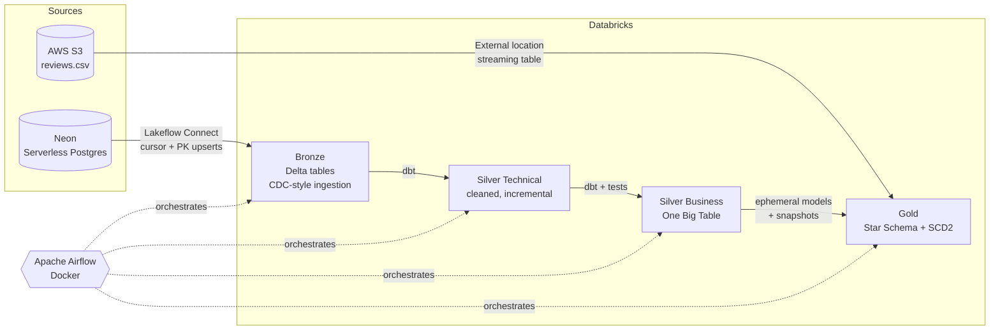

# 🛒 Walmart Lakehouse: End-to-End Data Engineering Project

> An end-to-end, production-style data engineering project built on a **Lakehouse architecture** using **Neon (serverless Postgres)**, **Databricks**, **dbt**, **Apache Airflow**, **Delta Lake** and **AWS S3**.


---

## 📌 Overview

This project simulates a real data engineering team workflow for a Walmart-style retail dataset. Data is ingested from a hosted Postgres database and an S3 data lake into Databricks, transformed with dbt through a **Bronze → Silver → Gold** medallion architecture, and orchestrated end-to-end with Apache Airflow running in Docker.

### Key concepts demonstrated

- Lakehouse architecture (Delta Lake on Databricks)
- CDC-style incremental ingestion using cursor columns and primary keys (idempotent upserts)
- Serverless Postgres source (**Neon**) with database **branching** for safe experimentation
- Metadata-driven pipelines using Jinja templating
- One Big Table (OBT) design
- Dimensional modeling: star schema, fact and dimension tables
- Slowly Changing Dimensions (**SCD Type 2**) using dbt snapshots
- Incremental models with upserts, ephemeral models, custom schema macros
- Data quality checks (generic and custom tests, severity levels)
- Orchestration with Airflow: custom Docker image, dbt integration, Databricks job triggering via SDK
- Scheduling and backfilling (`catchup`, `start_date`)
- Version control and deployment to GitHub

---

## 🏗️ Architecture



| Layer | Schema | Description |
|---|---|---|
| **Bronze** | `walmart.bronze` | Raw Delta tables ingested incrementally from Postgres |
| **Silver Technical** | `walmart.silver_t` | Cleaned 1:1 versions of bronze tables, incremental with upserts |
| **Silver Business** | `walmart.silver_b` | `obt`: one big table, generated dynamically with Jinja |
| **Gold** | `walmart.gold` | Star schema: dimensions (SCD2) + fact table |

---

## 🧰 Tech Stack

| Tool | Purpose |
|---|---|
| **Neon** | Hosted serverless Postgres source database (with branching) |
| **Databricks (Free Edition)** | Lakehouse platform, Spark, Delta Lake, Unity Catalog |
| **dbt Core + dbt-databricks** | Transformations, tests, snapshots |
| **Apache Airflow 3.x** | Orchestration and scheduling |
| **Docker / Docker Compose** | Running Airflow locally with a custom image |
| **AWS S3** | Data lake for the reviews file |
| **Git & GitHub** | Version control and portfolio deployment |
| **VS Code + dbt Power User** | IDE for dbt development (query preview, lineage, Jinja support) |
| **uv** | Python package and environment manager |

---

## 📂 Repository Structure

```
.
├── airflow/
│   ├── dags/
│   │   └── orchestrate.py          # Main DAG
│   ├── plugins/
│   ├── config/
│   ├── logs/
│   ├── walmart_project/            # dbt project (bind-mounted into Airflow)
│   │   ├── models/
│   │   │   ├── source/             # sources.yml
│   │   │   ├── silver_t/           # technical layer + properties.yml (tests)
│   │   │   ├── silver_b/           # OBT (metadata-driven Jinja)
│   │   │   └── gold/
│   │   │       ├── ephemeral/      # eph_customers, eph_products, ...
│   │   │       └── fact/           # fact_orders
│   │   ├── snapshots/              # dim_*.yml (SCD Type 2)
│   │   ├── macros/                 # custom generate_schema_name
│   │   ├── tests/                  # custom singular tests
│   │   ├── dbt_project.yml
│   │   └── profiles.yml
│   ├── Dockerfile                  # Custom Airflow image with dbt installed
│   ├── docker-compose.yaml
│   ├── requirements.txt
│   └── .env
├── data/                           # Walmart dataset (DDL + CSV files)
└── README.md
```

> Adjust folder names to match your actual repo.

---

## 🗃️ Dataset

A simulated Walmart retail dataset with six source tables in the `raw` schema of the Neon Postgres database:

`customers` · `employees` · `orders` · `order_items` · `products` · `stores`

plus a standalone `reviews.csv` file that lives in S3.

---

## 🔄 Pipeline Walkthrough

### 1. Source: Neon Postgres
- Created a Neon project with a `walmart_db` database and a `raw` schema.
- Ran the DDL script from `data/` to create the six tables, then loaded the CSV files (e.g. `COPY` / `psql \copy`, or a Python loader).
- Used a Neon **branch** as a safe sandbox for ad-hoc queries and schema checks, so the main branch stays untouched.
- Databricks connects to Neon over a Postgres connection (`walmart_conn`); Neon requires SSL (`sslmode=require`).

### 2. Bronze: CDC-style ingestion (Databricks)
- Created the `walmart` catalog and `bronze` schema in Unity Catalog.
- Built a Databricks **Lakeflow Connect** pipeline for PostgreSQL, using the Neon connection.
- Each table uses `updated_timestamp` as the **cursor column** and its ID as the **primary key**, giving incremental loads, upserts and idempotency with no CDC setup on the source.
- Verified idempotency: re-running the pipeline produced 0 upserts and no duplicates.
- A Databricks **Job** wraps the pipeline so it can be triggered externally.

### 3. Silver Technical: dbt incremental models
- Sources are registered in `sources.yml` for lineage.
- Models are `incremental` with a `unique_key` for upserts:

```sql

  where updated_timestamp >= (
    select coalesce(max(updated_timestamp), '1900-01-01') from {{ this }}
  )

```

- Custom `generate_schema_name` macro removes the default `dbt_` schema prefix.
- Data tests in `properties.yml` (`unique`, `not_null`, price `> 0`, with `warn`/`error` severity).

### 4. Silver Business: metadata-driven One Big Table
- The OBT joins orders, customers, order items, products, employees and stores.
- Instead of a static SQL query, a **Jinja config list** (table, columns, alias, join condition) drives the generated `SELECT` / `FROM` / `LEFT JOIN` through loops and `loop.first` / `loop.last` logic.
- Adding a column or table is a config change, not a query rewrite.
- Includes a custom singular test that checks key columns for nulls.

### 5. Gold: Star schema with SCD Type 2
- **Ephemeral models** (`eph_customers`, `eph_products`, `eph_stores`, `eph_employees`, `eph_orders`) define each dimension as a query without materializing it.
- **dbt snapshots** build the SCD2 dimensions (`dim_customers`, `dim_products`, `dim_stores`, `dim_employees`, `dim_orders`) with `timestamp` strategy, `dbt_valid_from`, `dbt_valid_to` and `dbt_updated_at`.
- **`fact_orders`** holds natural join keys and numeric measures (`quantity`, `unit_price`, `line_amount`, `total_amount`).
- Includes a `dim_orders` (the "dimension of the model itself") for order-level context.

### 6. S3 reviews ingestion
- Created an S3 bucket and a Databricks **external location** (via the AWS quick-start stack).
- `reviews.csv` is loaded into a Delta **streaming table** that picks up new files automatically.

### 7. Orchestration: Apache Airflow
Runs in Docker with a **custom image** (`Dockerfile`) that installs `dbt-core` and `dbt-databricks`. The dbt project is bind-mounted into the containers.

DAG: `orchestrate`

```
ingest_cdc → clean_target → source_freshness → silver_technical → silver_technical_tests
          → silver_business → silver_business_tests → gold_ephemeral → gold_dimensions → gold_facts
```

- `ingest_cdc` triggers the Databricks job through the **Databricks SDK** and **polls the run state** until it terminates, so downstream tasks wait.
- dbt steps use `BashOperator` / `@task.bash` with `--select` to run one layer at a time, giving a readable task lineage in the Airflow UI.
- Schedule: daily at 11:00 (`0 11 * * *`), `catchup=False`.

---

## 🚀 Getting Started

### Prerequisites
- Python 3.11 or 3.12 (3.13 has limited dbt compatibility)
- Git, VS Code, Docker Desktop
- Accounts: GitHub, Databricks Free Edition (AWS), Neon, AWS

### 1. Clone and set up the environment
```bash
git clone https://github.com/<your-username>/<your-repo>.git
cd <your-repo>

pip install uv
uv sync
source .venv/bin/activate        # Windows: .venv\Scripts\activate
```

### 2. Set up the source database (Neon)
1. Create a free project at [neon.tech](https://neon.tech) and a database named `walmart_db`.
2. Copy the connection string from the Neon console (**Connect** button). It looks like:
   ```
   postgresql://<user>:<password>@<host>.neon.tech/walmart_db?sslmode=require
   ```
3. Create the `raw` schema and tables with the DDL script, then load the CSVs from `data/`:
   ```bash
   psql "<your-neon-connection-string>" -f data/ddl.sql
   ```
4. Store the connection string in `.env` (never commit it).

### 3. Set up Databricks
1. Create the `walmart` catalog and `bronze` schema.
2. Create a PostgreSQL connection to Neon (`walmart_conn`: host, port `5432`, database, user, password, SSL), then a Lakeflow Connect pipeline (cursor: `updated_timestamp`, key: table ID).
3. Wrap it in a Job and note the **Job ID**.
4. Create a personal access token for dbt and the SDK.

### 4. Configure dbt
Copy `profiles.yml` into the dbt project folder and fill in:

```yaml
walmart_project:
  target: dev
  outputs:
    dev:
      type: databricks
      host: <your-workspace-host>
      http_path: <sql-warehouse-http-path>
      token: <your-token>
      catalog: walmart
      schema: dbt_schema
      threads: 1
```

Test it:
```bash
cd walmart_project
dbt debug
dbt run
dbt test
dbt snapshot
```

### 5. Run Airflow
```bash
cd airflow
echo "AIRFLOW_UID=50000" > .env
docker compose build
docker compose up -d
```
Open [http://localhost:8080](http://localhost:8080) (default login `airflow` / `airflow`) and trigger the `orchestrate` DAG.

---

## 🛠️ Troubleshooting (Windows)

| Problem | Fix |
|---|---|
| `DLL load failed while importing strptime: An Application Control policy has blocked this file` (pandas 3.x with `dbt init`) | Pin pandas: `uv add "pandas<3.0.0"`. If still blocked, turn off **Smart App Control** (Windows Security → App & browser control), or run the project in WSL2. |
| `A project called walmart_project already exists here` after a crashed `dbt init` | Delete the partial folder (`Remove-Item -Recurse -Force .\walmart_project`) and rerun `dbt init`. |
| `No module named 'dbt.adapters.databricks'` in dbt Power User | The extension is using global Python. Select the `.venv\Scripts\python.exe` interpreter, then reload the window. |
| Red errors in `dbt_project.yml` | Keep connection details only in `profiles.yml`, never inside `dbt_project.yml`. |
| `uc: command not found` | Typo, the command is `uv`. |

---

## 🔐 Security Notes

- **Never commit** Databricks tokens (`dapi...`), Neon connection strings, passwords or `.env` files. Revoke and regenerate any token that was pasted in public or shared places.
- Replace all hosts and tokens in this repo with placeholders and rotate any token that was exposed.
- Add `target/`, `logs/`, `dbt_packages/`, `.env` and `profiles.yml` secrets to `.gitignore`, or use environment variables (`{{ env_var('DATABRICKS_TOKEN') }}`).

---

## 🧪 Data Quality

| Layer | Checks |
|---|---|
| Silver Technical | `unique` + `not_null` on keys, price `> 0` |
| Silver Business | Custom singular test for null keys in the OBT |
| Gold | SCD2 snapshots tracked with `dbt_valid_from` / `dbt_valid_to` |
| Sources | `dbt source freshness` task in the DAG |

---

## 💡 Interview Talking Points

- Why cursor-based incremental ingestion instead of native CDC or change tracking?
- Why OBT first, then a dimensional model?
- Metadata-driven pipelines vs. static SQL: benefits and trade-offs.
- Ephemeral models vs. views vs. tables.
- SCD Type 2 with dbt snapshots; why an `updated_at` column is needed.
- Fact table grain and composite primary keys (`order_id` + `order_item_id`); joining dimensions on **both** keys to avoid row explosion.
- Natural vs. surrogate keys, and when to use each.
- Airflow is an **orchestrator**, not a processing engine; why the task polls the Databricks job state.
- Granular dbt commands vs. one `dbt run` (task-level lineage, easier debugging), or Cosmos as an alternative.

---

## 🔭 Future Improvements

- Use [Astronomer Cosmos](https://github.com/astronomer/astronomer-cosmos) to auto-generate Airflow tasks from the dbt DAG
- Add surrogate keys with `dbt_utils.generate_surrogate_key`
- Add CI/CD with GitHub Actions (`dbt build` on pull requests)
- Trigger the S3 reviews pipeline from Airflow
- Add BI dashboards on top of the gold layer

---

## 🙏 Acknowledgements

Project based on the end-to-end data engineering tutorial by **Ansh Lamba**. Built with Databricks, dbt, Apache Airflow, Neon and Docker.

---

## 📜 License

This project is for educational and portfolio purposes. Add your preferred license (e.g. MIT).

---

⭐ If you found this project useful, give it a star!
